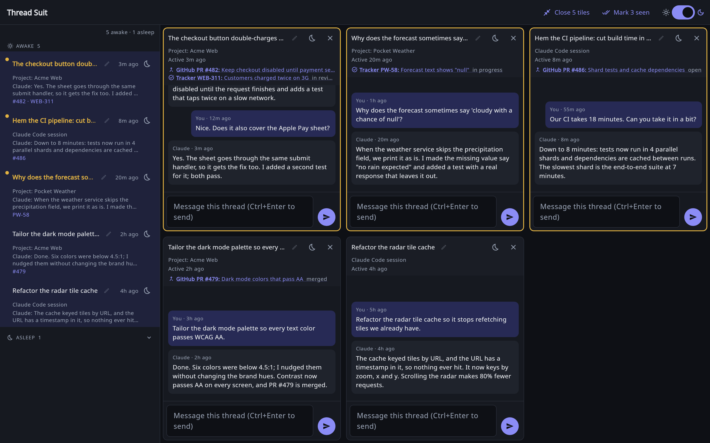

# Thread Suit

Keep track of many Claude threads at once, side by side, on macOS, Linux and Windows.



You started a Claude thread to fix a bug, a second to review a PR, a Claude
Code session over SSH to poke at a server, and three more you've already
forgotten. One of them finished an hour ago and is waiting for you. Which one?

Thread Suit is a small desktop app that keeps all of them in one place. It
lists every Claude project thread and Claude Code session that ran on your
computer, shows which ones have news, and lets you open several side by side
and reply without hunting through windows. It's tailored to people with too
many threads. (We're sorry about the puns. Not very sorry.)

It reads the session files Claude already keeps on your computer, so reading
threads costs no tokens and nothing leaves your machine. Sending a reply and
finding links do use Claude, a little, through your own Claude Code login
(see [Uses your Claude account](#uses-your-claude-account)).


## Features

- **Every thread in one list:** project threads, Claude Code sessions and SSH
  sessions, all in one place.
- **Unread at a glance:** you can see which threads have news.
- **Tiles, side by side:** open up to 9 threads at once, with their recent
  messages, in a grid that grows as you add them.
- **Reply from the tile:** send a message without switching windows.
- **Sleep:** park a thread until it has something new to say.
- **Links to what the thread is about:** its PRs and issues, from whatever
  git host or project manager your Claude can reach.
- **Instant updates (optional):** see new messages the moment they arrive.

## Requirements

- macOS, Linux or Windows.
- The [Claude desktop app](https://claude.ai/download) and
  [Claude Code](https://docs.claude.com/en/docs/claude-code), installed and
  signed in. Thread Suit runs the `claude` command for replies and links, so
  that use counts against the account Claude Code is signed in with.
- [Flutter](https://docs.flutter.dev/get-started/install), to build the app.

## Quick start

Install [Flutter](https://docs.flutter.dev/get-started/install) for your OS, then:

```bash
git clone https://github.com/BryanGWalsh/ThreadSuit.git
cd ThreadSuit
flutter run -d linux     # or -d macos, or -d windows
```

To build a release instead:

| OS | Build | The app |
|---|---|---|
| macOS | `flutter build macos --release` | `build/macos/Build/Products/Release/Thread Suit.app` |
| Linux | `flutter build linux --release` | `build/linux/x64/release/bundle/thread_suit` |
| Windows (experimental, untested) | `flutter build windows --release` | `build\windows\x64\runner\Release\thread_suit.exe` |

You can also open the folder in Android Studio or IntelliJ and use the
**Thread Suit** run configuration.

## Using it

- **Open a thread:** click it in the list to add it as a tile. A tenth tile
  closes the oldest; "Close N tiles" in the top bar clears them all.
- **Unread:** threads with new messages are gold in the list and have a gold
  border on their tile. Click a tile to mark it read, or "Mark N seen" to
  mark everything read.
- **Reply:** type in a tile and press ⌘↩ on macOS or Ctrl+Enter elsewhere.
  If the thread's session isn't running, the message waits until it is. It
  arrives marked as coming from Thread Suit, so Claude treats it as a
  request, not as your approval for anything that can't be undone.
- **Working notes:** in some project threads, Claude's side appears as
  "Working notes from this computer", collapsed; click "Show more" to read
  it all (see [What Thread Suit can see](#what-thread-suit-can-see)).
- **Rename:** click the pencil next to a title to give it your own name. It
  only changes what Thread Suit shows, never the thread in Claude; save an
  empty name to go back.
- **Sleep:** the moon button tucks a thread into the Asleep section until a
  new message arrives; the sun button wakes it sooner.
- **Light or dark:** use the switch at the top right. Until you flip it,
  Thread Suit follows your system.

## Instant updates (optional)

Thread Suit checks for new messages every 15 seconds. To see them the moment
they arrive, let Claude Code ping it with a small hook:

```bash
python3 tools/install_hook.py     # on Windows: py tools/install_hook.py
```

The hook can't slow down or break Claude Code, even when Thread Suit isn't
running. It only helps for Claude sessions on this computer (not SSH or cloud
sessions), and sessions that were already open need a restart to pick it up.
To remove it: `python3 tools/install_hook.py --uninstall`.

## How links work

Thread Suit doesn't know about GitHub, Jira or any other tool, and that's on
purpose. As long as Claude can reach your git host or project manager through
an MCP server, a plugin or a CLI tool, the PRs and issues a thread works on
show up under its title, like "GitHub PR #12: Fix login".

When a thread's links change, Thread Suit asks Haiku once, with a short
summary of what the thread touched. Haiku looks the items up with your own
tools, read-only, and leaves out anything it can't find. A link only shows
if its URL really appears in the thread or in what those tools returned, so
a thread with no git host or issue tracker gets no links at all.

A lookup is a small Haiku call, and Thread Suit keeps them rare and
remembers the results.
To turn them off, put `{"resolve_links": false}` in
`~/.thread-suit/config.json`; threads then show the plain URLs they mention.

## What Thread Suit can see

Everything the Claude desktop app and Claude Code keep on your computer:
project threads, Code sessions and SSH sessions started from the desktop app.
It can't see cloud-only sessions or sessions started only in a terminal. A
project thread's real title lives in the cloud, so Thread Suit shows the
start of your first message instead (rename it if you like).

If Claude's replies in a project thread don't match what the Claude app
shows, that's because the work ran in a session on this computer, which
reports to the project's assistant, and the reply the assistant posts is
stored only on claude.ai. Thread Suit shows the session's report instead:
the same substance, but longer and more technical.

Curious how it reads all that? [docs/FILE_FORMAT.md](docs/FILE_FORMAT.md) has
every file and setting.

## Uses your Claude account

Thread Suit has no AI account of its own. When it needs Claude, it runs your
`claude` command line (`claude -p` with the small Haiku model), so the call is
made with, and counted against, the account Claude Code is signed in with:
your plan's usage limits on a subscription, or your bill on an API key.

That happens for two things only:

- **Sending a reply:** one short Haiku call per message you send (if it
  fails, Thread Suit tries at most twice more, then stops).
- **Finding links:** one Haiku call when a thread's links change. It's on by
  default; turn it off with `{"resolve_links": false}` in
  `~/.thread-suit/config.json`.

Everything else, including reading every thread, is free and runs no Claude
calls.

## Privacy

Thread Suit runs entirely on your computer: no server, no account, no
analytics. It reads Claude's local files and writes only to its own folder,
`~/.thread-suit/`. The only things that leave your machine:

- **Sending a message:** your message, sent to Claude through your own
  Claude Code login.
- **Finding links:** a short summary of a thread's URLs and tool calls (never
  the whole conversation), sent the same way. You can turn it off.
- **Opening a link:** your browser opens it, as usual.

## Disclaimer

Thread Suit is an independent, unofficial project. It is not affiliated with,
endorsed by, or supported by Anthropic. "Claude" is a trademark of Anthropic.

Thread Suit reads file formats that Claude uses internally and doesn't
document. A Claude update can change them, and threads may then go missing
or look odd until Thread Suit catches up. If that happens, please open an
issue.

## Contributing

Issues and pull requests are welcome. See [CONTRIBUTING.md](CONTRIBUTING.md)
for the house rules and how to run the checks.

## License

[MIT](LICENSE). Wear it however you like.
